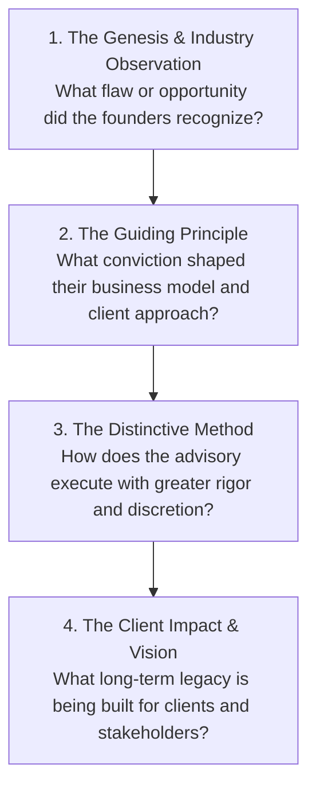

# Brand Narrative & Story Architecture

**Phase:** Section 06 — Business Discovery & Strategic Positioning  
**Status:** Working Discovery Framework  
**Last Updated:** 2026-11-22  

---

## 1. Principles of Authentic Brand Storytelling

- **Truth Over Mythmaking**: Ground the narrative in the founders' genuine motivations, industry observations, and tangible milestones.
- **Problem-Centricity**: The story begins with a genuine friction or failure in the traditional real estate landscape (e.g., misaligned incentives, opacity, transactional superficiality).
- **Client as the Hero**: Position the client (investor, family office, business owner) as the protagonist navigating a complex real estate landscape, with the firm serving as the trusted, discerning guide.

---

## 2. Core Narrative Arc (To Be Populated from Founder Conversations)

---

## 3. Discovered Narrative Elements

*(To be populated as founder quotes, origin stories, and business milestones are shared).*
