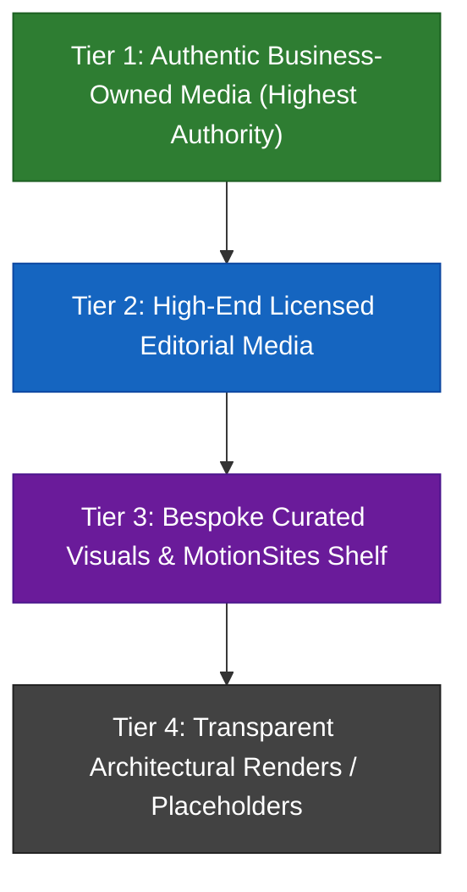

# Content & Entity Architecture Guidelines

## 1. Brand & Entity Integrity

To establish unambiguous entity recognition across search engines, knowledge graphs, and AI synthesis models, brand terminology must remain strictly standardized:

### 1.1 Standardized Identity Elements
- **Canonical Brand Name**: Standardized across metadata, page headers, footer copyright, and structured data schemas.
- **Entity Classification**: Identified primarily as `RealEstateAgent` and `ProfessionalService` under Schema.org hierarchy.
- **NAP Uniformity**: Name, Address, and Telephone format must be identical across website footers, Contact pages, Google Business Profiles, and structured JSON-LD schemas.

---

## 2. Standardized Service Taxonomy & Terminology

To avoid confusing visitors or search engines, the 7 confirmed service offerings must adhere to uniform nomenclature across the entire application:

| Confirmed Route | Canonical Service Title | Key Entity Scope & Focus |
| :--- | :--- | :--- |
| `/services/commercial` | **Commercial Real Estate** | Grade-A corporate offices, retail spaces, institutional acquisitions, and investment portfolios. |
| `/services/industrial` | **Industrial & Logistics** | Warehousing, manufacturing facilities, logistics parks, and distribution infrastructure. |
| `/services/land-plots` | **Land & Strategic Plots** | Institutional land tracts, development acreage, plotting, and strategic land acquisitions. |
| `/services/hotels` | **Hospitality & Hotels** | Luxury boutique resorts, premium business hotels, and institutional hospitality assets. |
| `/services/leasing` | **Corporate & Retail Leasing** | High-value commercial leasing, structured tenancy, negotiations, and tenant representation. |
| `/services/exchange-property` | **Property Exchange Advisory** | Strategic high-value asset swaps, structured 1031-like portfolio exchanges, and capital preservation. |
| `/services/sick-property` | **Distressed Asset Turnaround** | Underperforming asset rehabilitation, debt-resolution advisory, strategic recapitalization, and exit workouts. |

---

## 3. Media & Asset Sourcing Hierarchy

Integrity is paramount in luxury advisory. The platform establishes a strict four-tier hierarchy for all visual and editorial assets:

### Tier Definitions
1. **Tier 1 (Authentic Business-Owned Media)**: High-resolution photographs, architectural blueprints, and drone footage of properties directly represented or transacted by the advisory.
2. **Tier 2 (High-End Licensed Editorial Media)**: Professional architectural photography licensed through verified stock providers (Unsplash Pro, Getty Editorial, Adobe Stock) representing authentic design standards.
3. **Tier 3 (Curated MotionSites Media Shelf)**: Curated assets from `.agents/skills/motionsites-web-builder/media/` for atmospheric textures, abstract luxury materials, and cinematic backgrounds.
4. **Tier 4 (Transparent Architectural Visualizations)**: High-fidelity CGI / 3D architectural renders explicitly identified as conceptual visualizations or future projects.

### Strict Prohibitions
- **Zero Fabricated Testimonials**: Never invent client quotes, fake investor headshots, or fraudulent deal announcements.
- **Zero Fake Listings**: Never display imaginary property addresses, fictitious floor plans, or stolen property listings.
- **Zero Deceptive Metric Counters**: Avoid animated counters showing arbitrary numbers (e.g., "$50B+ in Deals Closed") unless verified by the founders.
