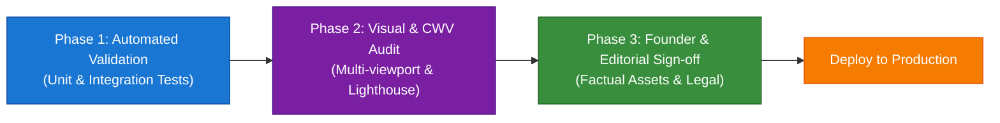

# Release Readiness Audit Matrix

## 1. Multi-Dimensional Release Quality Matrix

Before any candidate version of the luxury real estate platform is deployed to production, it must be audited and signed off against the following six critical operational dimensions:

| Dimension | Primary Audit Requirements | Verification Tool / Method | Target Quality Standard |
| :--- | :--- | :--- | :--- |
| **1. Visual & Motion Quality** | Responsive layouts across 6 viewports (360px to 1440px), fluid typography, negative space integrity, no horizontal scroll, zero visual pop. | MotionSites `shoot.py`, Playwright visual screenshots, Chrome DevTools | MotionSites 10-point score ≥ 8.0/10; no individual score < 7.0/10. |
| **2. Functional Correctness** | Form submissions, offer modal triggers, video player fa\u00e7ade, admin authentication, session lifecycle, offer filtering. | Playwright browser suites, Node/Express automated test suites | 100% test pass rate (Section 04 backend suite: 52/52 passing). Zero console errors. |
| **3. Technical SEO & Schema** | Canonical URLs, dynamic titles, meta descriptions, OpenGraph/Twitter tags, XML sitemap, robots.txt, JSON-LD Schema. | Google Rich Results Test, Schema Validator, Lighthouse SEO audit | 100/100 Lighthouse SEO; 0 schema errors; 100% canonical consistency. |
| **4. Accessibility (a11y)** | Keyboard navigability, visible focus rings, color contrast ratios (≥4.5:1 text, ≥3.0:1 UI), ARIA labels, reduced-motion compliance. | axe-core, Lighthouse Accessibility, keyboard walkthrough | WCAG 2.2 Level AA compliance; Lighthouse Accessibility ≥ 95. |
| **5. Performance & CWV** | LCP ≤ 2.5s, INP ≤ 200ms, CLS ≤ 0.1, responsive WebP/AVIF images, code splitting, deferred video embeds. | Google PageSpeed Insights, Chrome DevTools Performance panel | Green Core Web Vitals on mobile and desktop; Lighthouse Perf ≥ 90. |
| **6. Security & Data Integrity** | HttpOnly SameSite cookies, session TTL cleanup, bcrypt salt factor 12, rate limiting, no credential leaks, strict iframe origins. | OWASP ZAP, manual security code review, npm audit | Zero critical/high npm vulnerabilities; zero credential leakage in Git. |

---

## 2. Pre-Deployment Sign-Off Protocol

Every release candidate requires completion of the three-phase sign-off protocol:

1. **Phase 1: Automated Validation**
   - Run `npm run test:admin` (verifies admin auth, offer lifecycle, video URL sanitation).
   - Run build step `npm run build` (ensures zero syntax errors and optimal chunk bundling).
2. **Phase 2: Visual & CWV Audit**
   - Execute `shoot.py` across all public routes.
   - Run Lighthouse audit on mobile and desktop profiles.
3. **Phase 3: Founder & Editorial Sign-Off**
   - Verify that all property details, telephone numbers, and email addresses are verified by the business.
   - Confirm privacy policy and disclaimer text alignment with legal counsel.
