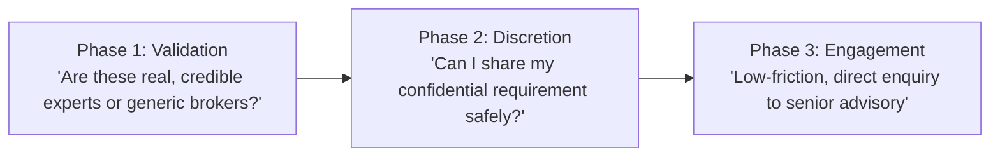

# Target Audience Analysis & Customer Segmentation

**Phase:** Section 06 — Business Discovery & Strategic Positioning  
**Status:** Working Discovery Framework  
**Last Updated:** 2026-11-22  

---

## 1. Candidate Audience Segments (To Be Validated)

Based on the 7 confirmed service subpages (`Commercial`, `Industrial`, `Land / Plots`, `Hotels`, `Leasing`, `Exchange Property`, `Sick Property`), we are investigating the following client segments:

### 1. Institutional Investors & Corporate Occupiers
- **Associated Services**: Commercial, Industrial, Leasing.
- **Profile**: Corporate real estate heads, fund managers, private equity partners, logistics developers.
- **Core Motivations**: Yield optimization, lease covenant strength, clear zoning, strategic geographical location, asset liquidity.
- **Pain Points**: Bureaucratic delays, opaque property titles, regulatory hurdles, lack of honest due diligence.
- **Trust Requirements**: Comprehensive underwriting, structural due diligence, transparent transaction history, market data accuracy.

### 2. High-Net-Worth Individuals (HNWIs) & Family Offices
- **Associated Services**: Hotels, Land / Plots, Commercial Assets, Exchange Property.
- **Profile**: Ultra-wealthy principals, second-generation family wealth managers, private business owners.
- **Core Motivations**: Capital preservation, multi-generational wealth creation, discreet portfolio restructuring, trophy asset acquisition.
- **Pain Points**: Aggressive public brokers, lack of privacy, market noise, time-wasting unqualified offers.
- **Trust Requirements**: Absolute confidentiality, off-market access, direct access to founders, fiduciary alignment.

### 3. Property Owners, Sellers & Distressed Asset Holders
- **Associated Services**: Sick Property (Distressed Turnaround), Exchange Property, Leasing.
- **Profile**: Asset owners facing liquidity crunches, stalled developments, complex multi-owner disputes, or non-performing real estate.
- **Core Motivations**: Debt resolution, recapitalization, tax-efficient asset exchange, turnaround and monetization.
- **Pain Points**: Distress exploitation by predatory buyers, legal complexity, public embarrassment.
- **Trust Requirements**: Discreet workout advisory, financial empathy, rapid execution capability, legal/regulatory structuring expertise.

---

## 2. Customer Decision-Making Framework

For each confirmed segment, the website must provide clear reassurance across three distinct psychological phases:

